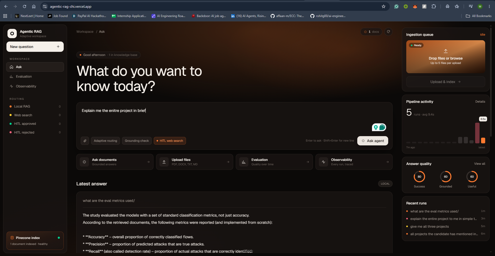
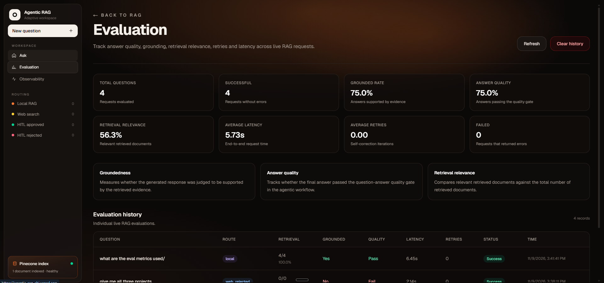
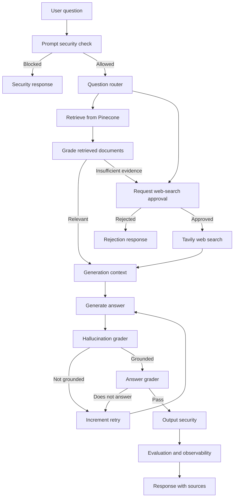
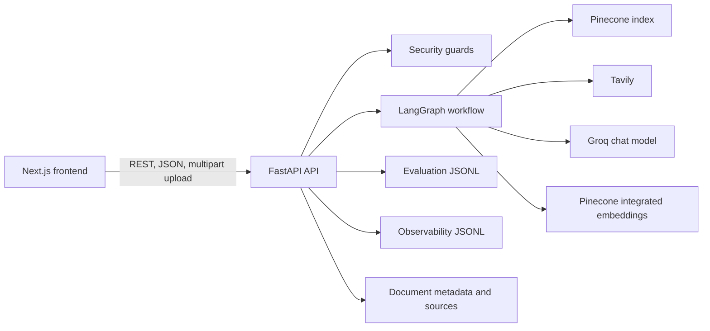

# Agentic Adaptive RAG

Agentic Adaptive RAG is a full-stack retrieval-augmented generation
application that chooses between a managed Pinecone knowledge base and Tavily
web search. It uses LangGraph to orchestrate retrieval, document grading,
answer generation, hallucination checks, retries, human approval, security
checks, evaluation, and observability.

The project has:

- A FastAPI backend for ingestion, chat, approval, evaluation, and
  observability.
- A Next.js frontend for document management, chat, evaluation, and
  observability dashboards.
- Pinecone for managed vector storage.
- Groq for chat generation and Pinecone-managed integrated embeddings.
- Tavily for web-search fallback.
- Docker and Docker Compose configurations for local development.

## Screenshots

**Ask workspace**: question prompt, latest grounded answer, ingestion queue,
pipeline activity and answer-quality rings.



**Evaluation**: grounded rate, answer quality, retrieval relevance, latency
and per-request history.



## Workflow



Web search is human-in-the-loop: the graph pauses before external search and
the frontend can approve or reject the request.

## Architecture



## Main capabilities

### Adaptive retrieval

The graph first considers local knowledge and uses Pinecone similarity search
for uploaded documents. Retrieved chunks are graded for relevance. If local
evidence is insufficient, the workflow can request approval and then search
Tavily.

### Document ingestion

The API accepts PDF, DOCX, TXT, and Markdown files. Documents are validated,
split into configurable chunks, embedded inside Pinecone, and written to the
configured Pinecone namespace. A SHA-256 document ID prevents the same file
from being indexed twice, and deterministic chunk IDs make re-indexing
repeatable.

### Quality gates

Generated answers are checked for grounding against the available context and
for whether they answer the original question. Failed checks can retry
generation up to the configured graph limit.

### Security

The security layer includes:

- Prompt-injection and instruction-override detection.
- Detection and wrapping of suspicious instructions in document content.
- Redaction of common credentials and sensitive environment values.
- Output-length protection.
- Conservative upload validation for supported file signatures and UTF-8 text.

These are application-level defensive controls, not a replacement for
authentication, authorization, rate limiting, secret management, or provider
security controls.

### Evaluation and observability

Interactive requests record route, retrieved and relevant document counts,
grounding, answer quality, retries, latency, sources, errors, and approval
state. The frontend exposes separate evaluation and observability dashboards.
Benchmark and RAGAS scripts are available under `backend/evaluation/`.

## Repository structure

```text
.
├── backend/
│   ├── api.py                 # FastAPI routes and application setup
│   ├── config.py              # Environment-backed configuration
│   ├── model.py               # Groq chat model
│   ├── ingestion.py           # Load, chunk, upsert, list, and delete documents
│   ├── retrieval.py           # Pinecone vector store and retriever
│   ├── migrate_to_pinecone.py # Re-index local files into Pinecone
│   ├── graph/                 # LangGraph state, chains, and nodes
│   ├── security/              # Prompt, content, and output guards
│   ├── evaluation/            # Benchmark, RAGAS, and report scripts
│   ├── documents/             # Example knowledge-base documents
│   └── tests                  # Backend unit tests
├── frontend/
│   ├── src/app/page.tsx       # Chat and document management
│   ├── src/app/evaluation/    # Evaluation dashboard
│   ├── src/app/observability/ # Observability dashboard
│   └── Dockerfile
├── Dockerfile                 # Backend container
├── docker-compose.yml         # Local backend/frontend deployment
├── requirements.txt
├── .env.example
└── README.md
```

## API

| Method | Path | Purpose |
|---|---|---|
| GET | `/` | API information |
| GET | `/health` | Health check |
| GET | `/documents` | List indexed documents |
| POST | `/upload` | Validate and index documents |
| DELETE | `/documents/{document_id}` | Delete a document and its chunks |
| POST | `/chat` | Ask a question |
| POST | `/chat/approval` | Approve or reject pending web search |
| GET/DELETE | `/evaluation` | Read or clear evaluation history |
| GET/DELETE | `/observability` | Read or clear observability history |

FastAPI's interactive documentation is available at `/docs`.

## Configuration

Copy `.env.example` to `.env` and set the provider credentials:

```env
GROQ_API_KEY=your_groq_api_key
TAVILY_API_KEY=your_tavily_api_key
PINECONE_API_KEY=your_pinecone_api_key
PINECONE_INDEX_NAME=agentic-adaptive-rag-integrated
PINECONE_NAMESPACE=default
```

Create a Pinecone integrated-embedding index before starting the API. The
current setup uses Pinecone's `multilingual-e5-large` model with the
`chunk_text` field mapped as the embedded text field. The application expects
the index name and namespace from the environment.

Other settings control the model, chunk size, chunk overlap, retrieval count,
frontend CORS origin, upload size, and optional LangSmith tracing. Never
commit `.env` or provider keys.

## Local setup

### Backend

```powershell
python -m venv .venv
.\.venv\Scripts\Activate.ps1
pip install -r requirements.txt
Copy-Item .env.example .env
# Add provider credentials and Pinecone settings to .env.
uvicorn backend.api:api --reload
```

The backend runs at `http://localhost:8000`.

### Frontend

In another terminal:

```powershell
cd frontend
npm install
$env:NEXT_PUBLIC_API_URL="http://localhost:8000"
npm run dev
```

The frontend runs at `http://localhost:3000`.

### Re-indexing documents

Documents from another vector store are not automatically transferred to
Pinecone. Re-index the original documents using:

```powershell
python -m backend.migrate_to_pinecone backend\documents
python -m backend.migrate_to_pinecone path\to\uploads
```

The ingestion code skips documents whose content hash is already present in
the configured Pinecone namespace.

## Docker Compose

From the repository root:

```powershell
docker compose build
docker compose up
```

The backend is available at `http://localhost:8000` and the frontend at
`http://localhost:3000`. Pass the same provider and Pinecone variables through
the root `.env` file.

## Testing

```powershell
python -m compileall -q backend
python -m pytest backend
```

For the frontend:

```powershell
cd frontend
npm install
npm run lint
npm run build
```

Tests that execute model or web-search calls require valid provider
credentials and may consume provider quota.

## Deployment

Render is sufficient for deployment of this application. Deploy the backend
and frontend as separate Render Web Services:

1. Deploy the root backend `Dockerfile`.
2. Set the backend provider keys, Pinecone settings, and `FRONTEND_URL`.
3. Deploy `frontend/` using its Dockerfile.
4. Set the frontend Docker build argument `NEXT_PUBLIC_API_URL` to the public
   backend URL.
5. Verify the backend `/health` endpoint and then upload a test document.

Pinecone keeps the vector index managed outside Render's filesystem. Uploaded
source files and JSONL evaluation/
observability history are still local application files; use object storage or
a database if those records must survive service restarts and redeployments.

Built by Meet Jain
