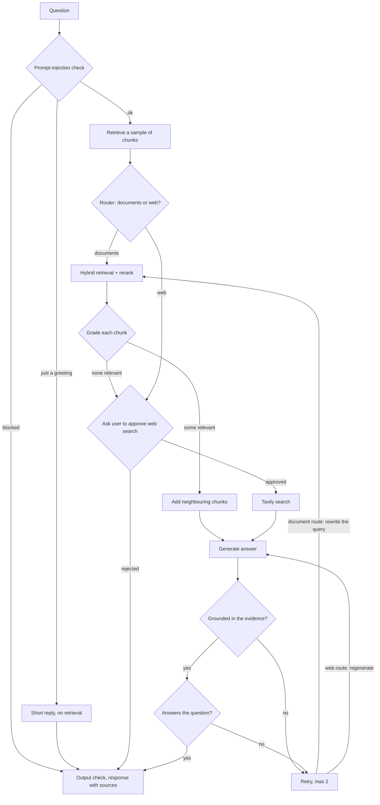

# Agentic Adaptive RAG

A question-answering app over your own documents. You upload PDFs, Word files
or text, ask questions, and get answers that cite the chunks they came from.
If the documents don't cover the question, the app asks for your permission
before it searches the web.

The interesting part is the backend: instead of a single retrieve-then-generate
call, it's a LangGraph state machine that routes each question, grades what it
retrieved, checks its own answer for hallucinations, and retries with a
rewritten query when the answer doesn't hold up.

**Live demo:** [agentic-rag-chi.vercel.app](https://agentic-rag-chi.vercel.app)
(backend on Render's free tier, so the first request after a while takes
30-60 seconds to wake it up)


## What happens when you ask a question



A few details that aren't obvious from the diagram:

- **The router looks at evidence, not just the question.** It's shown a few
  retrieved excerpts and decides whether the documents are about the topic.
  Routing on the question alone sends anything that sounds general to the web.
- **Web search is human-in-the-loop.** The graph pauses with a LangGraph
  `interrupt()`, the UI shows an approve/reject card, and the run resumes from
  a checkpoint. Checkpoints go to Postgres when `CHECKPOINT_DATABASE_URL` is
  set, so a pending approval survives a server restart.
- **Retries change the search, not just the wording.** If an answer from the
  documents fails a check, the question is rewritten into a better search
  query and retrieval runs again. Regenerating from the same chunks rarely
  fixes a retrieval miss.
- **Grading is cheap, generation gets context.** Chunks are graded at their
  normal size (~1,000 characters). The ones that pass are then joined with the
  chunk before and after them, so a list that was split across a chunk
  boundary (e.g. three projects on a resume) reaches the model whole.

## Retrieval

```text
query ─┬─ dense search (Pinecone, multilingual-e5-large) ── top 12 ─┐
       └─ keyword search (SQLite FTS5, BM25) ─────────────── top 12 ─┴─ reciprocal rank fusion
                                                                          │
                                         bge-reranker-v2-m3 (hosted) ◄────┘
                                                   │
                                              top 4 chunks
```

Dense search is good at meaning but misses exact names, IDs and acronyms;
BM25 catches those. The two lists are merged with reciprocal rank fusion and
then reranked by a cross-encoder. Each stage falls back to the previous result
if it fails, so a reranker outage degrades quality instead of breaking chat.

PDFs are parsed with `pypdf`. I tried PyMuPDF first because it keeps
headings, but it's AGPL-licensed, and every dependency here is meant to be
permissively licensed (MIT, BSD, Apache; psycopg is LGPL, which is fine as
an unmodified library). Scanned, image-only PDFs aren't OCR'd, so they index
as empty pages.

## Design decisions

**Embeddings and reranking run on Pinecone, not in the container.** The
backend is deployed on Render's free tier (512 MB RAM, a fraction of a CPU).
A local embedding model plus a reranker would not fit. With hosted inference
the API idles at about 110 MB, and parsing a 60-page PDF adds roughly 85 MB
at peak.

**Pinecone is the source of truth; SQLite is a disposable index.** The
document list and the BM25 index live in a local SQLite file. On startup the
API rebuilds it from Pinecone in a background thread. That matters on Render,
where the disk is wiped on every restart. It also means `/documents` is a
0.2 ms query instead of a 3 s scan of every vector.

**Uploads are idempotent.** A document's ID is the SHA-256 of its bytes and
chunk IDs are `{document_id}#{index}`, so uploading the same file twice is a
no-op. Upserts are batched to Pinecone's 96-record limit, and one corrupt file
in a batch upload is reported without failing the others.

**Separate models for answering and judging.** Answers use
`openai/gpt-oss-120b` on Groq at temperature 0.2. The router and the three
graders use the same model at temperature 0 with structured output, so their
yes/no decisions are repeatable.

**Retrieved text is treated as untrusted.** Documents and web pages are
wrapped and labelled as data in every prompt, user input goes through a
prompt-injection filter, and model output is scanned for leaked credentials
before it's returned.

## Evaluation and observability

Every request is logged with its route, retrieved vs. relevant chunk counts,
grounding and answer-quality verdicts, retries, latency and sources. Two pages
in the UI chart this over time.


For offline evaluation, `backend/evaluation/` has a benchmark runner (routing
accuracy, grounding, latency over a fixed question set) and a RAGAS script
(faithfulness, answer relevancy). RAGAS isn't in `requirements.txt` because
the app doesn't need it; install it separately (`pip install ragas`).

## Stack

| Layer | Choice |
|---|---|
| Orchestration | LangGraph, LangChain |
| LLM | Groq (`openai/gpt-oss-120b`) |
| Vector store, embeddings, reranker | Pinecone (integrated index, `multilingual-e5-large`, `bge-reranker-v2-m3`) |
| Keyword search, document registry | SQLite FTS5 |
| Web search | Tavily |
| HITL checkpoints | Postgres (e.g. Neon), falling back to SQLite |
| API | FastAPI |
| Frontend | Next.js 16, React 19, Tailwind CSS 4 |
| Hosting | Render (API), Vercel (frontend) |

## Running it locally

You need Python 3.11+, Node 20+, and API keys for
[Groq](https://console.groq.com), [Pinecone](https://app.pinecone.io) and
[Tavily](https://tavily.com). All three have free tiers.

### 1. Create the Pinecone index

In the Pinecone console, create an index with **integrated embedding**:

- Model: `multilingual-e5-large`
- Field map: `text` → `chunk_text`
- Metric: cosine

Name it `agentic-adaptive-rag-integrated`, or use any name and set
`PINECONE_INDEX_NAME` to match.

### 2. Backend

```bash
python -m venv .venv
source .venv/bin/activate          # Windows: .\.venv\Scripts\Activate.ps1
pip install -r requirements.txt
cp .env.example .env               # then fill in the three API keys
uvicorn backend.api:api --reload
```

The API runs on `http://localhost:8000`, with interactive docs at `/docs`.
Check `http://localhost:8000/health`; it should report your index as healthy.

### 3. Frontend

```bash
cd frontend
npm install
npm run dev
```

Open `http://localhost:3000`. The frontend calls `http://localhost:8000` by
default; set `NEXT_PUBLIC_API_URL` to point it somewhere else.

### Or with Docker

```bash
docker compose up --build
```

This starts both services on the same ports, reading keys from `.env`. The
`./data` volume keeps the SQLite registry and checkpoints between restarts.

## Deploying (Render + Vercel)

This is how the live demo is set up. Both have free tiers.

**Backend on Render**

1. New → Web Service → connect the repo. Pick the **Docker** runtime; the root
   `Dockerfile` already listens on Render's `$PORT`.
2. Add environment variables:

   ```env
   GROQ_API_KEY=...
   PINECONE_API_KEY=...
   TAVILY_API_KEY=...
   PINECONE_INDEX_NAME=agentic-adaptive-rag-integrated
   PINECONE_NAMESPACE=default
   FRONTEND_URL=https://your-app.vercel.app
   CHECKPOINT_DATABASE_URL=postgresql://...   # optional, see below
   ```

3. Deploy and open `https://<service>.onrender.com/health`.

`FRONTEND_URL` must match the frontend's address exactly (scheme and domain,
no path), or the browser will block requests with a CORS error.

Render's free disk is wiped whenever the service restarts or sleeps. The
document list and keyword index rebuild themselves from Pinecone, but a web
search that's waiting for approval would be lost. Point
`CHECKPOINT_DATABASE_URL` at a free Postgres database
([Neon](https://neon.tech) works) to keep those.

**Frontend on Vercel**

1. Import the repo and set the root directory to `frontend`.
2. Add `NEXT_PUBLIC_API_URL=https://<service>.onrender.com` (no trailing slash).
3. Deploy. This variable is baked in at build time, so redeploy after changing it.

## Configuration

Everything is set through environment variables; `.env.example` lists all of
them with defaults. The ones you're most likely to change:

| Variable | Default | What it does |
|---|---|---|
| `RETRIEVAL_K` | `4` | Chunks kept after reranking |
| `RETRIEVAL_CANDIDATES` | `12` | Chunks fetched from each search before fusion |
| `HYBRID_SEARCH` | `true` | Add BM25 keyword search alongside dense search |
| `PINECONE_RERANK_MODEL` | `bge-reranker-v2-m3` | Set empty to turn reranking off |
| `NEIGHBOR_CHUNKS` | `1` | Chunks added on each side of a relevant chunk; `0` turns it off |
| `CHUNK_SIZE` / `CHUNK_OVERLAP` | `1000` / `150` | Splitter settings, in characters |
| `LLM_TEMPERATURE` | `0.2` | Answer generation; graders always use 0 |
| `CHECKPOINT_DATABASE_URL` | empty | Postgres URL for durable web-search approvals |
| `MAX_UPLOAD_SIZE_MB` | `25` (`10` in `.env.example`) | Per-file upload limit |

## API

| Method | Path | Purpose |
|---|---|---|
| `POST` | `/chat` | Ask a question; returns an answer or an approval request |
| `POST` | `/chat/approval` | Approve or reject a pending web search (`thread_id`, `approved`) |
| `POST` | `/upload` | Upload and index up to 5 files |
| `GET` | `/documents` | List indexed documents |
| `DELETE` | `/documents/{id}` | Remove a document and all its chunks |
| `POST` | `/documents/sync` | Rebuild the local registry from Pinecone |
| `GET` | `/health` | Index status and document count |
| `GET`/`DELETE` | `/evaluation`, `/observability` | Read or clear run history |

## Project layout

```text
backend/
  api.py              FastAPI app and routes
  ingestion.py        parse → chunk → upsert, delete, dedupe
  retrieval.py        dense + BM25 search, rank fusion, reranking
  store.py            SQLite document registry and FTS5 keyword index
  graph/
    graph.py          the LangGraph state machine and routing logic
    chains/           router, graders, generator, query rewriter (prompts live here)
    nodes/            one file per graph step
    checkpoint.py     Postgres / SQLite / in-memory checkpointer
  security/           prompt-injection, content and output guards
  evaluation/         benchmark and RAGAS scripts
frontend/src/
  app/                Ask, Evaluation and Observability pages
  components/         sidebar, Markdown renderer, icons
```

## Tests

```bash
python -m pytest backend          # some tests call Groq/Pinecone and need keys
cd frontend && npm run lint && npm run build
```

## Known limitations

- **No authentication.** Everyone who can reach the API shares one Pinecone
  namespace. Don't put sensitive documents in a public deployment.
- **Run history is stored in local JSONL files,** so on Render it resets
  whenever the service restarts.
- **Groq's free tier is rate-limited.** A typical question makes about 8 model
  calls (routing, grading four chunks, generation, two answer checks), so
  rapid-fire questions can hit the limit.
- **No OCR.** Scanned PDFs without a text layer come out empty.

---

Built by [Meet Jain](https://github.com/MeetJain05).
